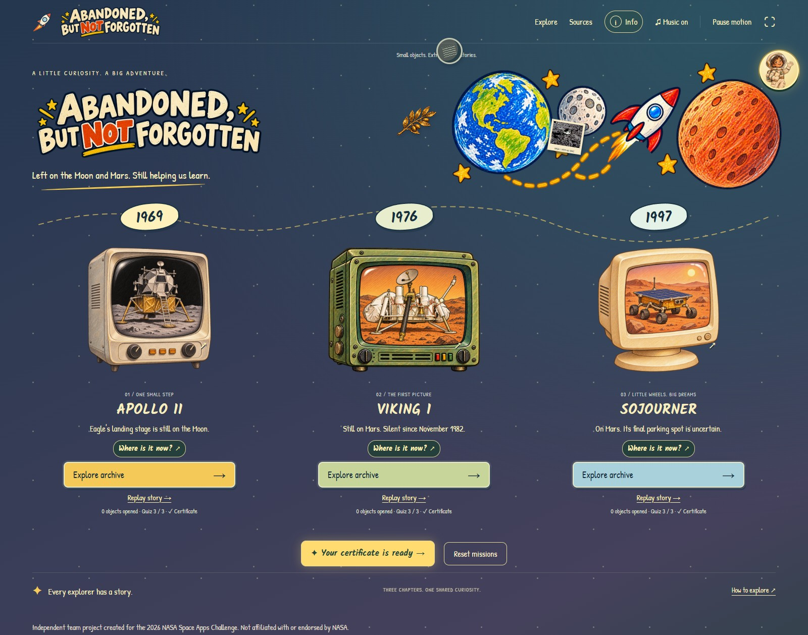
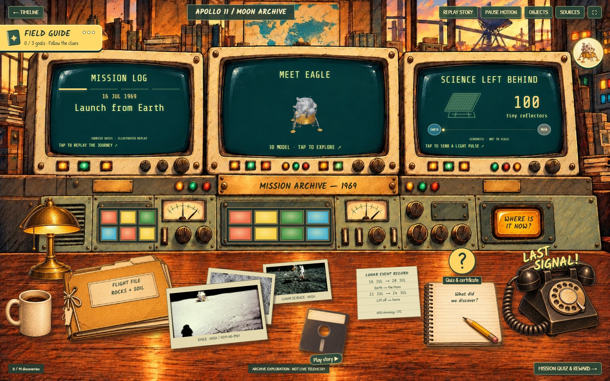
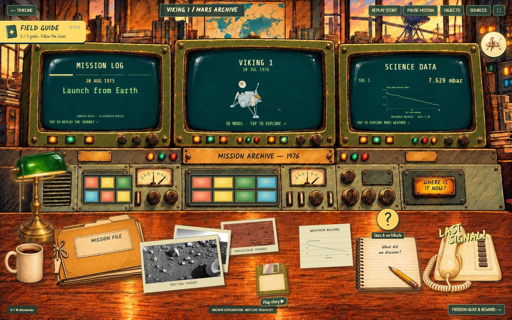
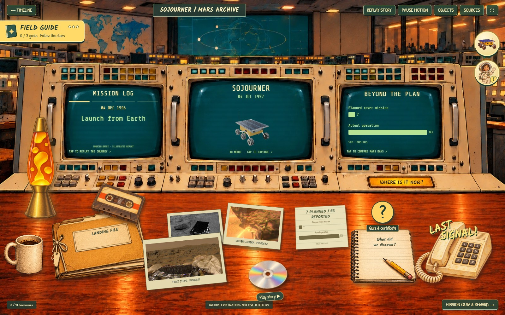
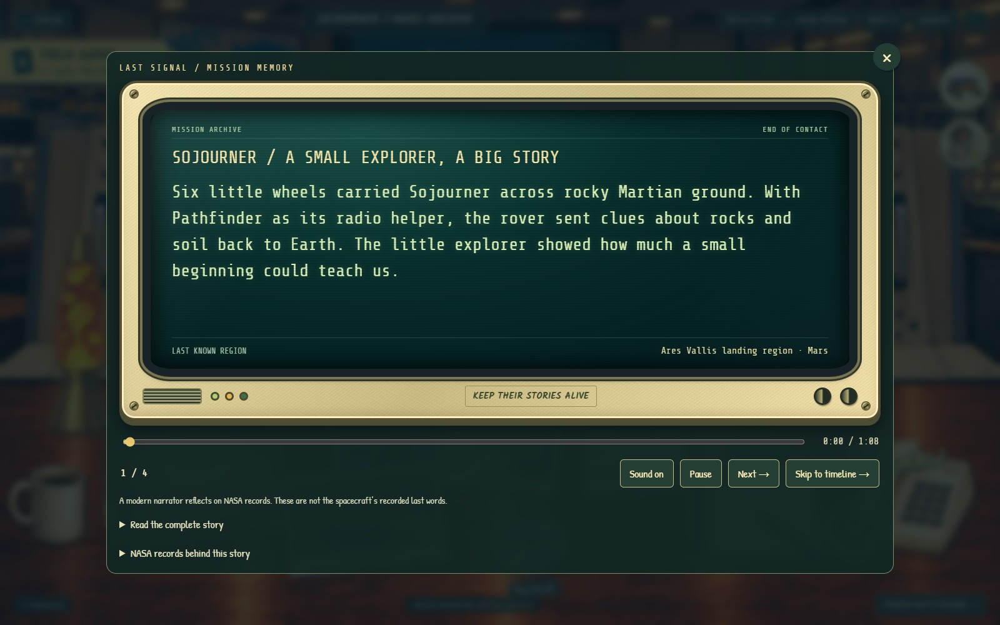
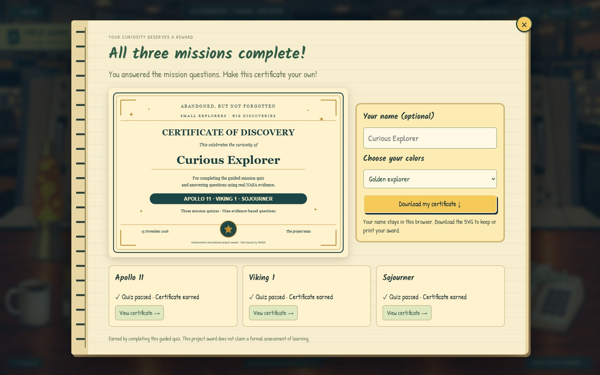
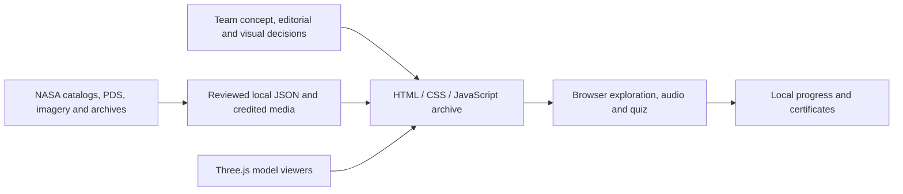

<div align="center">

# Abandoned, But Not Forgotten
### An Interactive Moon & Mars Archive

**Their Missions Ended. Their Stories Didn’t.**

An illustrated space-history adventure that puts school-age explorers in the mission-control chair.

[**Explore the live archive**](https://www.abandonedbutnotforgotten.org/) · [**Watch the demo**](https://youtu.be/UBaxWCMwD6A) · [**Project presentation — PDF**](docs/delivery/Abandoned-But-Not-Forgotten.pdf) · [**Space Apps submission**](SPACE_APPS_PAGE.md)

Independent project for the **2026 NASA Space Apps Challenge · Universal Local Event**

[](https://youtu.be/UBaxWCMwD6A)

</div>

## Three eras. Three control rooms. Three stories worth answering.

Spacecraft may stop transmitting, but their contribution to science does not disappear. Our archive helps children discover what stayed behind, why it stayed, and what it still teaches us.

- **1969, 1976 and 1997:** three distinct hand-illustrated environments for Apollo 11’s Eagle, Viking 1 and Sojourner.
- **Real evidence inside playful exploration:** original NASA photographs, NSSDCA catalog records, actual Viking weather measurements and NASA/JPL archive audio.
- **A complete mission story:** an illustrated arrival, hands-on control room, Where is it now? file, narrated Last Signal and a quiz that earns a personalized certificate.
- **Depth by design:** we chose three missions so children can investigate each one, then leave asking about the rest.



## Explore the missions

### Apollo 11 · 1969

Eagle brought Neil Armstrong and Buzz Aldrin to the Moon. Its lower stage remained as the launch platform for their departure; the upper stage’s eventual fate is uncertain. Explore a NASA lunar-module model, original surface photographs, the laser reflector and the instruments left behind.

[**Open the Moon archive →**](https://www.abandonedbutnotforgotten.org/#apollo)



### Viking 1 · 1976

A stationary science laboratory worked on Mars long after landing. Investigate its instruments and actual atmospheric pressure records, compare daily measurements, and discover how contact ended in 1982.

[**Open the Viking archive →**](https://www.abandonedbutnotforgotten.org/#viking)



### Sojourner & Pathfinder · 1997

A small six-wheeled rover depended on its lander to relay messages home. Explore the partnership, camera evidence, educational 3D reconstructions, the naming story and NASA/JPL podcast chapters. Compare seven planned sols with 83 actual sols. A sol is a Mars day, about 24 Earth hours and 40 minutes.

[**Open the Sojourner archive →**](https://www.abandonedbutnotforgotten.org/#sojourner)



## The past is calling. Your mission is to answer.

| In the control room | What children can do |
|---|---|
| **First journey** | Watch an illustrated journey, arrival film and voiced CRT welcome. Each mission plays its introduction on first entry; Replay story is available later. |
| **Three working CRTs** | Replay the mission timeline, inspect a rotatable 3D model and investigate lunar science, real Viking pressure or Sojourner’s mission duration. |
| **Desk objects and photographs** | Open source-linked exhibits. The Objects menu checks off visited objects and offers another way to reach them. |
| **Floppy disk or CD** | Listen to a short, child-friendly narrated mission story. These are modern storytelling recordings, not historical transmissions. |
| **Sojourner cassette** | Choose four NASA/JPL podcast excerpts and follow their English transcripts. |
| **Where is it now?** | Open a direct NSSDCA-linked file with the hardware’s condition, why it remained and a dated orbital photograph. |
| **Ringing telephone / Last Signal** | Hear a sourced, emotional modern narration, then watch the CRT fade and return to the timeline. It is not the spacecraft’s authentic final speech. |
| **Field Guide and explorer guides** | Follow evidence clues and optional practice questions; request help from the illustrated guide. |
| **Notebook quiz and reward** | Answer three guided questions to earn that mission’s certificate, with confetti, optional name and color choices. Complete all three quizzes for the combined award. |
| **Saved progress** | Resume on the same browser or reset missions from the homepage. No account is required. |

These are connected activities, not a compulsory linear sequence. Collecting every object is not required to earn the quiz certificate.

### When the archive goes quiet

The ringing phone opens **Last Signal**: a short, sourced narration that connects the mission’s ending with what remains today.



### Curiosity gets a reward

Three guided answers earn a mission certificate. Children can choose a name and color, download their award and continue toward the combined three-mission certificate.



## Why three missions?

We chose storytelling depth over a large catalog. Three eras give children time to recognize each machine, inspect evidence and understand how a mission can end while its scientific legacy continues. The design aims to encourage curiosity; we do not claim a measured improvement in learning outcomes.

## Real NASA data and historical sources

| Source | What Was Used | Where It Appears in the App | Link |
|---|---|---|---|
| NASA NSSDCA: Apollo 11 LM / EASEP, **1969-059C** | Eagle’s stages, surface equipment and the uncertain fate of the ascent stage | Apollo exhibits, Where is it now? and Last Signal | [Catalog record](https://nssdc.gsfc.nasa.gov/nmc/spacecraft/display.action?id=1969-059C) |
| NASA NSSDCA: Viking 1 Lander, **1975-075C** | Lander identity, landing region, instruments and mission ending | Viking room and status file | [Catalog record](https://nssdc.gsfc.nasa.gov/nmc/spacecraft/display.action?id=1975-075C) |
| NASA NSSDCA: **MESURPR** and **1996-068A** | Sojourner rover and Pathfinder lander, their separate roles and communications link | Sojourner exhibits, relay explanation and status file | [Sojourner](https://nssdc.gsfc.nasa.gov/nmc/spacecraft/display.action?id=MESURPR), [Pathfinder](https://nssdc.gsfc.nasa.gov/nmc/spacecraft/display.action?id=1996-068A) |
| NASA PDS: **VL1/VL2-M-MET-4-DAILY-AVG-PRESSURE-V1.0** | Thirty actual Viking 1 daily mean pressure samples, sols 1–30, PRESS_MEAN in mbar; source rows and quality flags retained | Animated Viking CRT and interactive weather investigation | [Dataset](https://pds.nasa.gov/ds-view/pds/viewDataset.jsp?dsid=VL1/VL2-M-MET-4-DAILY-AVG-PRESSURE-V1.0), [raw table](https://pds-atmospheres.nmsu.edu/PDS/data/vl_1001/data/vl_avep.dat) |
| NASA LRO/LROC: Apollo 11 landing site | Orbital photograph identifying the lower landing stage and surface trails | Apollo Where is it now? | [NASA image page](https://science.nasa.gov/resource/apollo-11-landing-site/) |
| NASA HiRISE: **PIA01881** and **PIA09105** | Viking 1 lander cutout and annotated Pathfinder hardware view | Viking and Sojourner status files | [Viking](https://science.nasa.gov/photojournal/viking-lander-1-thomas-a-mutch-memorial-station-imaged-from-orbit/), [Pathfinder](https://science.nasa.gov/photojournal/mars-pathfinder-landing-site-and-surroundings/) |
| NASA Apollo surface photographs | Original evidence including **AS11-40-5961** and **AS11-40-5952** | Photo albums, Eagle and lunar-science investigations | [Apollo 11 image library](https://www.nasa.gov/wp-content/uploads/static/history/alsj/a11/images11.html) |
| NASA Photojournal: **PIA00381**, **PIA00611**, **PIA00638**, **PIA00672** and other individually credited images | Original surface views, rover/lander hardware and camera evidence | Viking and Sojourner photograph collections | [First Viking image](https://science.nasa.gov/photojournal/first-photograph-taken-on-mars-surface/), [Pathfinder mission](https://science.nasa.gov/mission/mars-pathfinder/) |
| NASA Historical Sounds: **Eagle Has Landed** | An unchanged 5.364-second historical audio clip; transcript context is separately identified | Apollo journey investigation | [NASA archive](https://www.nasa.gov/historical-sounds/) |
| NASA/JPL, **On a Mission S4E2: First Steps: Sojourner** | Four selected podcast excerpts with source intervals, speakers and transcripts; edited for listening clarity | Chapter-based Sojourner cassette player | [Podcast and transcript](https://www.nasa.gov/podcasts/on-a-mission/first-steps-sojourner-s4e2/) |
| NASA 3D Resources / **Michael D. Carbajal** | Original Apollo Lunar Module and Viking Lander geometry; viewing materials and lighting adjusted | Interactive Apollo and Viking model viewers | [Apollo model](https://science.nasa.gov/3d-resources/apollo-lunar-module/), [Viking model](https://science.nasa.gov/3d-resources/viking-lander/) |
| NASA NSSDCA objectives and NASA/JPL technical paper | **7 planned / 83 actual Martian sols**; one sol is about 24 Earth hours 40 minutes | Sojourner duration comparison and learning activities | [Objectives](https://nssdc.gsfc.nasa.gov/planetary/mesur.html), [JPL paper](https://www-robotics.jpl.nasa.gov/media/documents/ICESpaper.pdf) |

Every source has a specific role. The complete claim/source map is in [archive.json](public/content/archive.json); original image identities, credits and hashes are in [media.json](public/content/media.json). [Viking pressure provenance](public/content/viking-pressure.json) retains the original rows and flags; [podcast provenance](public/content/sojourner-recordings.json) identifies each excerpt and its processing.

Orbital photographs are dated archive images, not live views. Sojourner’s exact final parking location is not confirmed. The Sojourner and Pathfinder models are project-authored educational reconstructions from NASA references, not NASA-issued engineering CAD. Illustrative flights, light paths and CRT effects are not measured telemetry.

## What the team created

The team selected the school-age audience, the three-mission scope and the archive concept. Human decisions guided storytelling, source selection, historical interpretation, art direction, interaction design and final review. AI tools supported production and implementation; the project’s purpose and editorial choices remained team-led.

| Team member | Responsibility |
|---|---|
| **Enes Yasir ARICAN** | Project Lead & Technical Coordinator — software engineering, integration and technical review |
| **Semih KARTAL** | Research & Fact-Checking Lead — NASA source research and content verification |
| **Görkem AYGEL** | Art Direction & Visual Review — illustration style and visual consistency |
| **Emre ARICAN** | Usability & Testing Lead — interaction review, usability and application testing |

The control rooms are fictional archive environments, not reconstructions of actual NASA control rooms. The certificate is an independent project reward, not a NASA-issued qualification or proof of measured learning.

## AI use and other resources

| Tool | Purpose | Disclosure / Labeling |
|---|---|---|
| **OpenAI Codex** | Software implementation, integration assistance, explanatory text and automated checks | Project Info, source documentation and AI usage records |
| **OpenAI ImageGen / ChatGPT** | Illustrated control rooms, interface artwork, fictional guides and visual production assistance | Shared project Info and per-asset provenance records |
| **ChatGPT + Kling AI** | Team-supplied illustrated arrival films | Project Info and video provenance records |
| **ElevenLabs** | Mission introductions, archive stories, naming story and Last Signal narration | Project Info, descriptive provenance and MP3 metadata; separate from historical audio |
| **Suno** | Homepage music | Project Info and audio provenance/metadata |

The team confirms paid-plan production of the Suno music and ElevenLabs narration. Original NASA photographs, scientific records, the Apollo historical clip and NASA/JPL podcast voices are credited separately from generated illustrations and synthetic narration. See [AI_DISCLOSURE.md](AI_DISCLOSURE.md) and [THIRD_PARTY.md](THIRD_PARTY.md).

Other dependencies: **Three.js** (MIT), **Draco** (Apache-2.0), **esbuild** (MIT), **Playwright** (Apache-2.0), and locally served **Kalam**, **Patrick Hand** and **Share Tech Mono** fonts (SIL OFL). Retained trial fonts have their own OFL files. No space-agency partnership or endorsement is claimed.

## Technical approach

The application is static HTML, CSS and vanilla JavaScript ES modules with Three.js. Local JSON files separate source records, media provenance, scientific measurements and story content from the interface. Only the selected mission initializes its model viewer. Movies, audio and full evidence load when used; browser storage holds optional progress.



### Run locally

Requires Node.js and npm. The application needs no API keys or backend service.

```sh
git clone https://github.com/yasirarican-droid/hackathon2026.git
cd hackathon2026
npm ci
npm run preview
```

Open **http://127.0.0.1:4186/**. The viewer bundle is included. Rebuild it only after changing viewer source:

```sh
npm run build:viewer
```

Checks use an installed Chrome browser:

```sh
npm run check
npm test
npm run test:learning
```

If Chrome is missing, install it with `npx playwright install chrome`. Test reports are generated locally. Serve **public/** with any static HTTPS host; development files and credentials do not belong in the public web root.

## Known limits and future chapters

The experience is **English-only**, designed for **landscape exploration**, and currently contains **three missions**. Smaller portrait devices show a rotate prompt. Browser policy can require a tap before sound, video or fullscreen starts. Progress is specific to a browser/origin. Automated checks do not replace physical-device, screen-reader or child usability studies.

**Opportunity and Ingenuity** are possible future chapters, not implemented missions or promised releases. We would keep the same emphasis on source evidence and storytelling depth.

## License and independence

Project-authored source code is licensed under **Apache-2.0**: [LICENSE](LICENSE), [NOTICE](NOTICE). NASA data, photographs, models, fonts, recordings and generated media retain their own applicable terms; the code license does not relicense them. See [THIRD_PARTY.md](THIRD_PARTY.md).

**An independent educational project created for the 2026 NASA Space Apps Challenge. Not affiliated with or endorsed by NASA.**

[Explore the archive](https://www.abandonedbutnotforgotten.org/) · [Watch the demo](https://youtu.be/UBaxWCMwD6A) · [Editable presentation](docs/delivery/Abandoned-But-Not-Forgotten.pptx)
